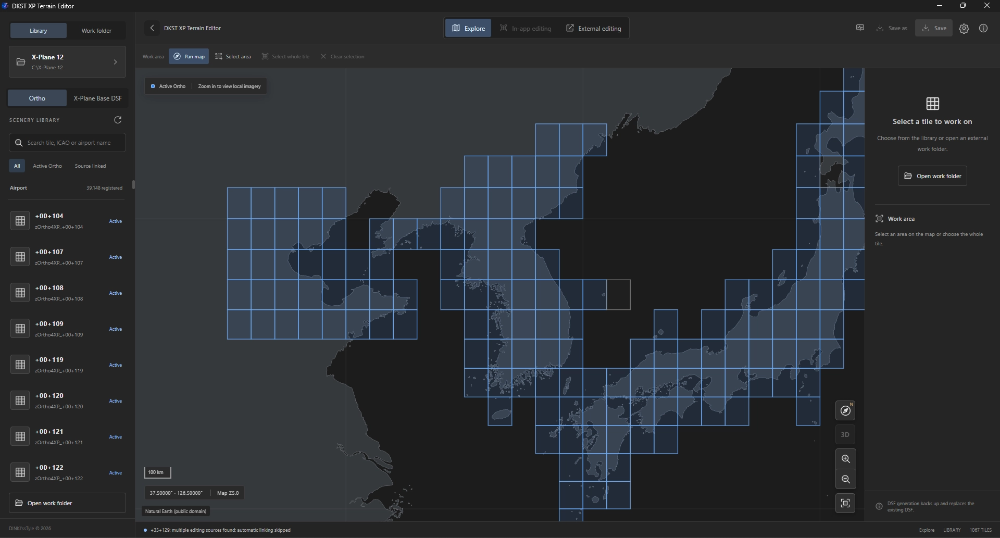
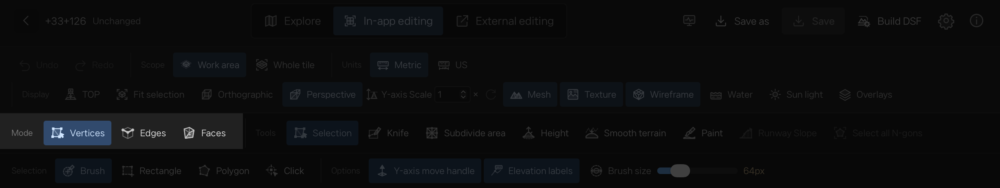
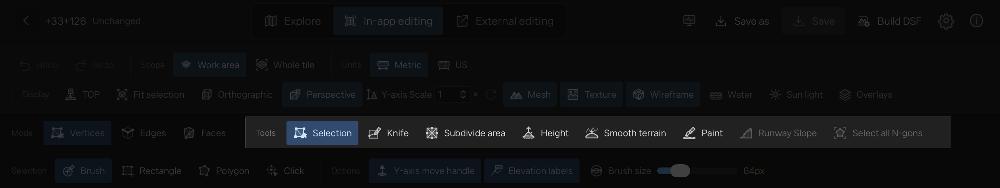

# DKST XP Terrain Editor 사용법을 단계별로 알아봅니다.

## 화면 이해하기

DKST XP Terrain Editor(이하 앱)를 실행했을 때 보이는 화면입니다. 우측 상단에 설정 버튼  이 있습니다. 앱 사용을 시작하기 전에 설정에서 X-Plane 설치 위치를 지정해 주세요.

#### 설정
- **Language**: 앱의 언어를 영어 또는 한국어로 선택할 수 있습니다.
- **Work without X-Plane**: X-Plane이 없는 컴퓨터에서 사용할 때 체크합니다.
- **X-Plane 12 installation folder**: X-Plane 12의 설치된 위치를 지정합니다.
- **Maximum backup**: 작업 타일의 최대 백업 개수를 지정합니다.
- **OBJ editing application**: 외부 편집 시 3D 앱을 바로 연결하려면 지정합니다.
- **Right-drag rotation**: 마우스 우클릭 드래그 시 뷰포트 이동 방식을 설정합니다.
  - Look rotation: X-Plane 내부에서 사용하는 방식입니다.
  - Orbit around cursor only on selection: 선택한 지점을 기준으로 뷰포트를 이동합니다.
  - Orbit around cursor: 커서 지점을 기준으로 뷰포트를 이동합니다.
- **Use OpenStreetMap background**: 지도를 탐색하기 위해 OSM 온라인 지도를 이용할 수 있습니다. 이 옵션이 꺼져 있으면 오프라인 Natural Earth world map을 사용하여 단순하지만 강력한 벡터 지도를 이용할 수 있습니다.

### 설정 완료 후
X-Plane 폴더가 지정되면 앱은 X-Plane 12의 \Global Scenery, \Custom Scenery\scenery_pack.ini 파일을 읽어 데이터베이스를 생성합니다. 이후 앱을 실행했을 때 변경 사항이 있으면 Rescan 메시지 창이 표시됩니다.

## 좌측 사이드 패널
작업할 타일들을 보여줍니다.
### Library
- **Ortho**: scenery_pack.ini 중 Ortho4XP로 제작된 타일 목록입니다.
- **X-Plane Base DSF**: X-Plane의 기본 지형 타일 목록입니다.

검색창에 공항 이름(X-Plane에서 표시되는 이름)이나 ICAO 코드를 입력하여 세계 지도를 검색하고 이동할 수 있습니다.

### Work folder
현재 작업 중이거나 과거에 작업했던 타일들을 표시합니다. 상단에 작업 폴더를 고정하거나, 최근 작업한 5개 타일, 그리고 이전에 시도했던 타일(이하 프로젝트) 목록을 볼 수 있습니다. 이는 해당 타일 폴더 내부에 dkst 폴더가 있는지 여부로 판단됩니다.

## 중앙 작업 공간
지도를 탐색하거나 인앱 편집을 수행하는 공간입니다.

### Explorer
지도를 탐색하는 모드입니다.
- **Pan Map**: 지도를 이동합니다.
- **Select area**: 편집할 영역을 선택합니다.
- **Select whole tile**: 타일 전체를 선택합니다.
- **Clear selection**: 선택된 영역을 취소합니다.

### In-app editing
앱 안에서 지형을 수정하고, 반영할 수 있습니다.

인앱 편집에 진입하기 전에 다음 사항을 고려하세요.
- 일반적으로 Ortho로 제작된 타일은 폴리곤 수가 매우 많습니다. 앱은 과도한 폴리곤 수를 제한하며, 앱의 제약과 관계없이 컴퓨터 성능에 따라 작업이 버거울 수 있습니다. 따라서 **Select area** 기능을 사용하여 국소적인 편집부터 시작하는 것을 권장합니다.
- 편집은 꼭 필요한 부분만 최소한으로 수정하는 것이 좋습니다. 폴리곤이 많아질수록 사용자 컴퓨터에 부하가 커집니다.

### External editing
타일 또는 선택한 작업 영역을 Wavefront .OBJ 파일로 내보낼 수 있습니다. 내보낼 때 해당 영역의 텍스처까지 포함되어 익숙한 3D 도구에서 편리하게 편집할 수 있습니다.

## In-app editing 사용해보기
X-Plane의 지형은 3D 메시(Mesh)로 구성되어 있으며, 이 메시지는 삼각형으로 이루어져 있습니다. 정점(Vertex)과 정점 사이의 선(Edge)들이 그려지고, 이 선들이 모여 면(Face)을 형성합니다. 면이 세 개의 정점을 가지면 삼각형입니다. 하지만 정점이 세 개를 초과하면 N각형이라고 부릅니다. 우리 앱은 편집 편의성을 위해 N각형을 지원하며, DSF로 빌드할 때 자동으로 삼각형으로 변환합니다.

세 가지 편집 모드를 지원합니다.
- **정점(Vertices)**: 정점을 선택하고 편집할 수 있습니다.
- **모서리(Edges)**: 선을 선택하고 편집할 수 있습니다.
- **면(Faces)**: 면을 선택하고 편집할 수 있습니다.

- 편집 모드를 선택하고, Tools에서 Selection을 선택하세요.
Selection은 모드에 따라 다음과 같은 방식으로 선택할 수 있습니다.  
  - **공통**: Brush, Rectangle, Polygon, Click
  - **Faces**: Normal Break Selection 

- **Brush**: 마우스 드래그를 사용하여 연속적으로 선택할 수 있습니다.
- **Rectangle**: 사각형을 그려 영역을 선택할 수 있습니다.
- **Polygon**: 다각형을 그려 원하는 영역을 선택할 수 있습니다.
- **Click**: 클릭 한 번으로 개별적으로 선택합니다.
- Faces에서 사용 가능한 **Normal Break Selection**: 면의 노말 각도에 따라 선택 영역을 지정합니다.

