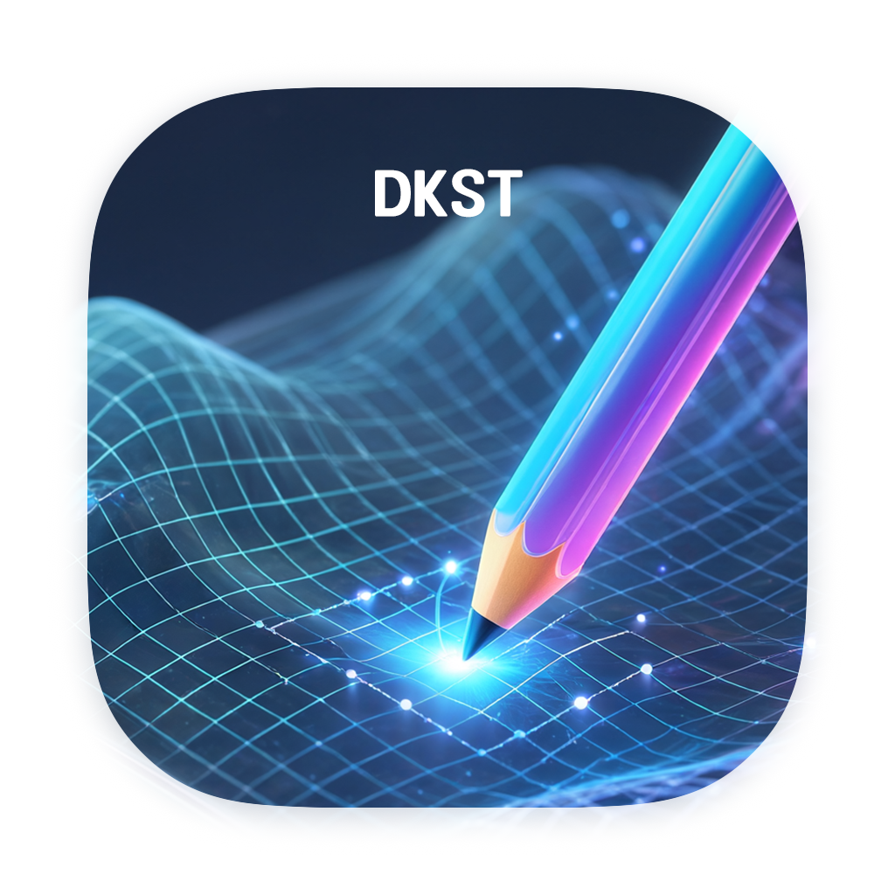

## DKST X-Plane Ortho Editor

  

  
  
  
  

**English** · [한국어](Apps/DKST-X-Plane-Ortho-Editor/README.ko.md) · [한국어 사용자 매뉴얼](Apps/DKST-X-Plane-Ortho-Editor/user-guide.ko.md)

DKST X-Plane Ortho Editor is a desktop application for browsing X-Plane Ortho scenery and editing terrain elevations and mesh topology. You can save an edited tile as a full Ortho4XP `.mesh` or apply the edits to an existing scenery DSF. This documentation covers version 0.14.0.

**[User guide](Apps/DKST-X-Plane-Ortho-Editor/user-guide.en.md)**

## Features

| Feature | What you can do |
| --- | --- |
| Scenery browser | Find Ortho tiles in the X-Plane library or open a work folder directly. Inspect the work area or the whole tile in 2D and 3D. |
| 3D viewport | Toggle mesh, imagery, wireframe, and water. Use top, orthographic, or perspective views and exaggerate the displayed elevation with Y-axis Scale. |
| Vertex and face editing | Select with Brush, Rectangle, Polygon, or Click. Enter elevations, flatten a selection, or drag the Y-axis handle with Soft Selection. Store named selections in the project. |
| Mesh topology | Cut faces, subdivide selected faces, or merge faces into an N-gon. Converting an N-gon to triangles can improve internal diagonals on coplanar terrain. |
| Terrain brushes | Raise or lower terrain, smooth slopes, or paint a mask and apply elevation changes to it. |
| Runway Slope | Edit an actual terrain cross-section along a drawn direction. Use reference images, a soft brush, point alignment, and a knife to refine the profile. |
| External editing | Export OBJ, MTL, and textures. Inspect the edited OBJ and merge it back into the tile, with a repair-copy workflow for supported defects. |
| DSF output and backups | Reuse existing scenery assets, validate the generated DSF, and back up the current file before replacement. |
| Tile projects | Keep edits, recovery data, exports, and build results inside the Ortho tile's `dkst` folder. Reopen the tile folder to resume work. |

## Workspaces

- **Explore** to inspect scenery and define a work area.
- **In-app editing** to edit terrain directly.
- **External editing** to round-trip a mesh through Blender or another 3D editor.

## Download
[X-Plane Ortho Editor Download](https://github.com/DINKIssTyle/DKST-Apps/releases/tag/xporthoeditor)

   

## DKST GIF Converter

  

  
  
  
 

### This is a multi-functional tool that can convert video clips to GIF, WebP, and WebM. It offers features such as cropping, resizing, trimming, background transparency, along with simple sticker and text overlay options.

#### Key Features
- Single segment In/Out editing, automatic FPS/speed calculation, manual frame count/delay
- Auto-zoom selected segment, precise trim by holding handles, vertical playback line navigation on track
- Handle drag crop, aspect ratio lock/independent height/scale resize
- Korean multi-line captions with emojis, font/color/background/shadow styles, time display and drag position editing
- Move/scale/rotate with text/sticker selection handles. Shift for horizontal move, aspect ratio scale, 5-degree rotation
- 157 stickers across 6 categories, import transparent images (PNG/JPEG/WebP/GIF/BMP)
- Frame-by-frame movement, J/K/L navigation and playback looping
- Switch between Settings / Overlays in the right sidebar
- Forward/Reverse/ping-pong, GIF loop count and last frame wait
- 2-256 color settings for Ordered/Error Diffusion, gifski high-quality auto coloring
- Default enabled GIF playback compatibility mode: resamples short frames while maintaining one cycle length
- Output to GIF/MP4/WebP/WebM and switch format-specific Settings, maintaining common and format-specific values
- WebP lossy/lossless · quality · compression effort · repeat settings, MP4 (H.264)/WebM (VP9) quality · encoding speed
- GIF/WebP transparent background: retain original alpha or remove specified color, set color/HEX · frame dropper · tolerance range, select opaque background color
- Preview image/video before saving, check actual size/resolution, explicit Save, Undo
- Confirm cycle time · frame count · loop count recorded in the final GIF

### Download
[GIF Converter Download](https://github.com/DINKIssTyle/DKST-Apps/releases#release-GIFConverter)

   

## DKST Wikiviewer

  

  
  
  
  
 

### Enjoy offline Wikipedia and ZIM archives anytime, anywhere. Save once, access forever—no internet required. Knowledge at your fingertips, made easier than ever.

#### Overview
Explore Knowledge Offline, Your Way.
DKST Wikiviewer is a powerful and lightweight ZIM file viewer designed to open offline Wikipedia and ZIM archives anytime, anywhere. Experience seamless offline reading with fast search, custom bookmarks, random page discovery, and a continuous Text-to-Speech (TTS) engine that turns any article into an audio experience.

#### Key Features
- Complete ZIM Archive Viewer
- Seamlessly open and browse Wikipedia, Wiktionary, TED talks, and other ZIM archives completely offline without relying on an internet connection.
- Lightning-Fast Search
- Instantly query massive offline databases. Find articles, terms, and topics in seconds.
- Continuous Text-to-Speech (TTS) Player
- Turn articles into audiobooks. Listen to continuous TTS playback across pages—perfect for commuting, working out, or multitasking while learning on the go.
- Smart Bookmarks & History
- Save essential articles for instant access later and easily track your reading history to pick up right where you left off.
- Random Page Discovery
- Spark your curiosity with a single tap. Explore new and unexpected topics randomly selected from your loaded ZIM archives.
Why You'll Love DKST Wikiviewer
- 100% Offline Independence: Save your bandwidth and access the sum of human knowledge even in remote areas, during flights, or under low-connectivity conditions.
- Distraction-Free Reading: Enjoy a clean, optimized reader view focused entirely on your reading and listening experience.
- Hands-Free Learning: Continuous TTS playback allows you to effortlessly consume knowledge without having to stare at the screen.

### Download
[Wikiviewer Download](https://github.com/DINKIssTyle/DKST-Apps/releases/tag/Wikiviewer)

   

> This is a collection of DKST series apps without separate public repositories.

